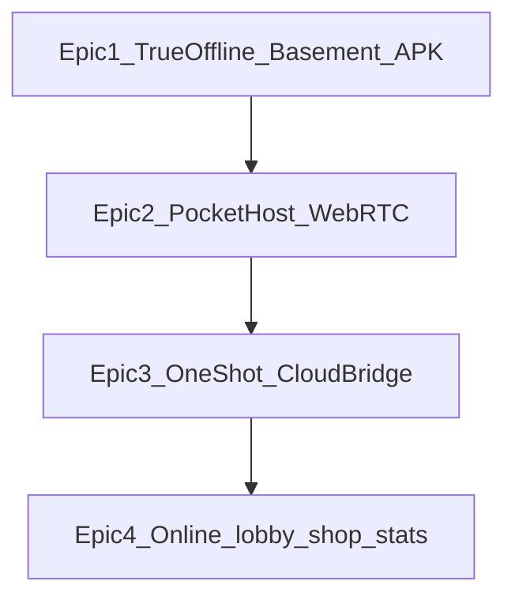

# Очередь видения Up&Down (один эпик за раз)

Правило: **в работе только текущий эпик**. Остальное живёт здесь, чтобы идеи не терялись.

**Канон денег / free / Premium:** [PRODUCT-TIERS.md](./PRODUCT-TIERS.md).  
**Канон хостов (A `.cmd` / B `.exe` / C карман / D облако):** [HOST-MODES-CANON.md](./HOST-MODES-CANON.md).

| # | Эпик | Статус | Суть |
|---|------|--------|------|
| **1** | Полный офлайн + подвал Wi‑Fi + APK по LAN | **✅ сделано** (режим **A**; `.exe` режим **B** — упаковка позже) | ПК = хост, гости по QR на :3001/play/. Панель :3927 create без аккаунта. Free |
| **2** | Хост в кармане (WebRTC) + deep link | **следующий** (скаффолд; ещё не играбельно) | Телефон = хост без ПК. **Платный слой (Premium / Special)** — [PLAN-DALEE.md](./PLAN-DALEE.md) волна **0b** |
| **3** | Разовый локальный→облачный мост | очередь | «На одну партию» лёгкий туннель; при массовости — общий сервер |
| **4** | Онлайн-продукт + витрина SKU | очередь | Лобби, чат, инвайты, магазин; слои — [PRODUCT-TIERS.md](./PRODUCT-TIERS.md) |

## Две разные вещи (не путать в текстах)

| | **Подвал с сервером на ПК** (эпик 1) | **Хост в кармане** (эпик 2) |
|--|--|--|
| Кто хост | Ноутбук / ПК | Телефон хоста |
| Что крутится | Панель + игровой сервер на ПК | Комната на телефоне (WebRTC), без Node на iPhone |
| Что делают гости | QR → браузер (или APK на Android) | QR / deep link → к телефону-хосту |
| Деньги | Free + **аккаунт на create** | Premium / Special (когда готово) |
| Сейчас | Уже можно играть по LAN | Ещё не играбельно |

## Канон продукта (кратко)

- **Free + аккаунт:** подвал ПК, облачный стол (база), офлайн vs ИИ.  
- **Premium сейчас:** полный разбор истории + премиум-косметика (`#premium`). Карман **не** обещать на витрине до готовности.  
- **Позже платно:** хост в кармане; опционально отдельный SKU «утилита Special».  
- **Не делаем:** плата за Wi‑Fi-подвал сейчас; лимит столов/день как тариф; репост → вечный буст комнат.

Подробности слоёв: [PRODUCT-TIERS.md](./PRODUCT-TIERS.md).

## Якоря идей (эпик 4 — не сейчас)

- Магазин ништяков + полноценные награды.
- Статистика и **деликатные** описания стиля игры (офлайн-характер / онлайн-стиль).
- Общий лобби онлайн + видимость в списках (по умолчанию: все вошедшие в аккаунт; ручная скрытность — позже).
- Общий чат с анти-помойкой; приглашения в комнаты; открытые и скрытые приватные комнаты.
- Витрина SKU: обычная / Premium / Special «свой хост».

## Эпик 1 — как пользоваться (кнопки)

1. Панель на ПК → **«У нас уже есть Wi‑Fi»** или **«Сделаем свой Wi‑Fi с телефона»**.  
2. Хост **входит в аккаунт** на `/play/` (тот же Wi‑Fi / localhost).  
3. **«Запустить игру»** → **«Создать стол с QR»**.  
4. Гости: камера на QR (аккаунт не обязателен).  
5. APK (по желанию): **«Получить APK»**.

Хост с телефона без ПК = эпик 2 (ещё не готов, платный слой).

Подробности: [OFFLINE-PARTY.md](./OFFLINE-PARTY.md), [OFFLINE-PARTY-STATUS.md](./OFFLINE-PARTY-STATUS.md).
