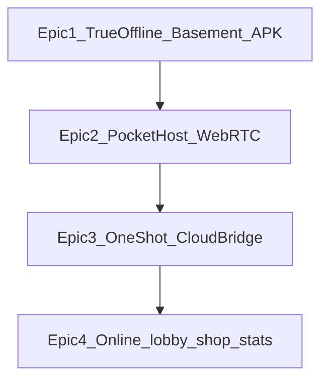

# Очередь видения Up&Down (один эпик за раз)

Правило: **в работе только текущий эпик**. Остальное живёт здесь, чтобы идеи не терялись.

| # | Эпик | Статус | Суть |
|---|------|--------|------|
| **1** | Полный офлайн + подвал Wi‑Fi + APK по LAN | **✅ сделано** (полировка по багам) | **Спец с сервером на ПК:** ноут = хост, гости по QR в браузере (hotspot/роутер) |
| **2** | Хост в кармане (WebRTC) + deep link | **следующий** (скаффолд; ещё не играбельно) | **Телефон = хост без ПК**; скан → комната (не то же самое, что эпик 1). В плане: [PLAN-DALEE.md](./PLAN-DALEE.md) волна **0b** |
| **3** | Разовый локальный→облачный мост | очередь | «На одну партию» лёгкий туннель; при массовости — общий сервер |
| **4** | Онлайн-продукт + витрина SKU | очередь | Лобби, чат, инвайты, магазин; **обычная / спец / доп. «свой хост»** (см. канон ниже) |

## Две разные вещи (не путать в текстах)

| | **Спец с сервером на ПК** (эпик 1) | **Хост в кармане** (эпик 2) |
|--|--|--|
| Кто хост | Ноутбук / ПК | Телефон хоста |
| Что крутится | Панель + игровой сервер на ПК | Комната на телефоне (WebRTC), без Node на iPhone |
| Что делают гости | QR → браузер (или APK на Android) | QR / deep link → к телефону-хосту |
| Сейчас | Допиливаем, уже можно играть по LAN | Ещё не играбельно |

## Канон продукта: обычная vs спец (эпик 4 — витрина, не сейчас кодить магазин)

- **Обычная** — бесплатно; в UI **нет** кнопки «Свой хост». В разделе «Онлайн» — тизер: есть платная спец / доп. с вечеринкой-хостом + ссылка на информацию и скачивание.
- **Спец** — платно; в установленном пакете есть «Свой хост» + дистрибутив хоста/сервера **там, где платформа позволяет** (в первую очередь ПК / позже Android-гость и карманный хост).
- **Докупка** к уже скачанной обычной: утилита «Свой хост» за доп. плату (тот же capability, отдельный SKU).
- Пакеты витрины (когда дойдём): отдельно мыслить Win / Linux / Android / iOS — на iOS нет «Node-сервера в комплекте», там путь через приложение + позже эпик 2.

## Якоря идей (эпик 4 — не сейчас)

- Магазин ништяков + полноценные награды.
- Статистика и **деликатные** описания стиля игры (офлайн-характер / онлайн-стиль).
- Общий лобби онлайн + видимость в списках (по умолчанию: все вошедшие в аккаунт; ручная скрытность — позже).
- Общий чат с анти-помойкой; приглашения в комнаты; открытые и скрытые приватные комнаты.
- Витрина SKU: обычная / спец / доп. «свой хост» (см. канон выше).

## Эпик 1 — как пользоваться (кнопки)

1. Панель на ПК → выбрать карточку **«У нас уже есть Wi‑Fi»** или **«Сделаем свой Wi‑Fi с телефона»**.  
2. Большая кнопка **«Запустить игру»** → **«Создать стол с QR»**.  
3. Гости: камера на QR.  
4. APK (по желанию): **«Получить APK»**.

Хост с телефона без ПК = эпик 2 (ещё не готов).

Подробности: [OFFLINE-PARTY.md](./OFFLINE-PARTY.md), [OFFLINE-PARTY-STATUS.md](./OFFLINE-PARTY-STATUS.md).
